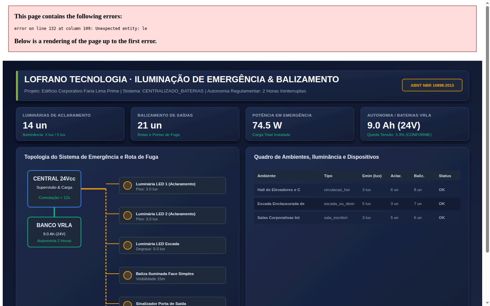
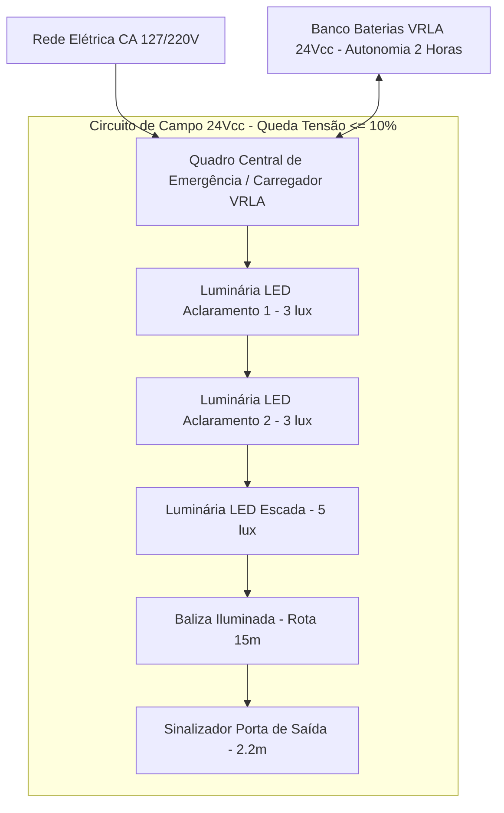

# dimensionamento-iluminacao-emergencia-nbr10898

[](https://github.com/martinlofranodeoliveira/dimensionamento-iluminacao-emergencia-nbr10898/actions/workflows/ci.yml)
[](https://www.python.org/downloads/)
[](LICENSE)
[](pyproject.toml)
[](src/iluminacao_nbr10898/calculator.py)

Motor computacional em Python puro (biblioteca padrão exclusiva) para projeto e dimensionamento de **sistemas de iluminação de emergência e balizamento de rotas de fuga** em estrita conformidade com a norma **ABNT NBR 10898:2013** (*Sistema de iluminação de emergência*).

O sistema dimensiona os dois subsistemas regulamentares fundamentais: **iluminação de aclaramento** (níveis mínimos de iluminância no plano do piso em lux) e **iluminação de balizamento** (sinalização contínua de rotas e saídas de emergência), com verificação de espaçamentos máximos, uniformidade luminosa, cálculo elétrico de queda de tensão em circuitos de campo (24 Vcc) e dimensionamento de banco central de acumuladores selados VRLA com autonomia ininterrupta de 2 horas.

---

## 📸 Painel Técnico de Engenharia

O módulo gera automaticamente um painel esquemático vetorial (SVG 1440x900) e exportação de alta resolução contendo a topologia do sistema, quadro de cargas de campo e balanço de autonomia energética:



---

## 🎯 Escopo Normativo (ABNT NBR 10898:2013)

### 1. Iluminação de Aclaramento (Itens 5.1 e 5.2)
Garante a iluminação de ambientes e rotas de fuga para prevenir o pânico e permitir a evacuação segura:
- **Áreas planas horizontais** (corredores, halls, salas corporativas): mínimo de **$3{,}0\text{ lux}$** no plano do piso.
- **Escadas, passagens com desnível e obstáculos**: mínimo de **$5{,}0\text{ lux}$** no plano do piso e degraus.
- **Locais de trabalho com risco potencial elevado** (subestações elétricas, salas de máquinas, caldeiras): mínimo de **$5{,}0\text{ lux}$**.
- **Espaçamento máximo entre luminárias**: não deve ultrapassar 4 vezes a altura de montagem ($d_{\text{max}} \le 4 \cdot h_{\text{montagem}}$) para evitar zonas de sombra e ofuscamento.
- **Uniformidade luminosa**: a relação entre iluminância máxima e mínima não deve superar $40:1$.

### 2. Iluminação de Balizamento e Rotas de Fuga (Item 5.3)
Sinalizadores autônomos ou centralizados que indicam o sentido das saídas e mudanças de direção:
- **Distância máxima entre sinalizadores**:
  - Sinalizadores de face simples: até **$15{,}00\text{ m}$** de visibilidade direta;
  - Sinalizadores de face dupla (iluminação bilateral): até **$30{,}00\text{ m}$**.
- **Posicionamento obrigatório**:
  - Diretamente sobre todas as vergas de portas de saída de emergência (altura regulamentar entre $2{,}00\text{ m}$ e $2{,}50\text{ m}$);
  - Em todas as mudanças de direção, bifurcações e entroncamentos de corredores;
  - Junto a cada lance de escada de emergência e portas corta-fogo.

### 3. Autonomia e Tempo de Resposta (Item 5.4)
- **Autonomia contínua regulamentar**: Mínimo ininterrupto de **2 horas (120 minutos)**. Ao final da autonomia, o fluxo luminoso das luminárias não pode declinar para menos de 70% do nominal.
- **Tempo máximo de comutação**:
  - Blocos autônomos e centrais de baterias: acendimento imediato ($\le 5\text{ segundos}$);
  - Grupos Moto-Geradores (GMG): partida e comutação automática de transferência em até **12 segundos**.

### 4. Dimensionamento Luminotécnico Analítico
Utiliza o método analítico dos lúmens com formulação racional exata:
$$\Phi_{\text{requerido}} = \frac{E_{\text{min}} \cdot A}{\eta \cdot f_m}$$
$$N_{\text{lum}} = \left\lceil \frac{\Phi_{\text{requerido}}}{\Phi_{\text{unitário}}} \right\rceil$$
onde $E_{\text{min}}$ é a iluminância mínima requerida (3 ou 5 lux), $A$ é a área ($m^2$), $\eta$ é o fator de utilização ($0{,}60$ em superfícies claras ou $0{,}50$ em escuras/galpões) e $f_m = 0{,}80$ é o fator de manutenção e depreciação.

### 5. Cálculo Elétrico de Circuitos Centralizados (24 Vcc)
Para sistemas centralizados, a norma limita a queda de tensão máxima na linha de distribuição a **10%** da tensão nominal ($\Delta V \le 2{,}40\text{ V}$ em $24\text{ Vcc}$):
$$R_{\text{linha}} = \frac{\rho \cdot L}{S}$$
$$\Delta V = I_{\text{circuito}} \cdot R_{\text{linha}}$$
$$\% \Delta V = \frac{\Delta V}{V_{\text{nom}}} \times 100 \le 10\%$$

### 6. Banco Central de Baterias Seladas VRLA
Dimensionamento com fator de segurança e envelhecimento de **25%** ($1{,}25$):
$$C_{\text{mínima}} = \left( I_{\text{total}} \times T_{\text{autonomia}} \right) \times 1{,}25\quad [\text{Ah}]$$

---

## 📐 Topologia Esquemática



---

## 🚀 Instalação e Execução

### Pré-requisitos
- Python 3.11 ou superior instalado.
- Nenhuma dependência externa necessária (100% biblioteca padrão).

### Execução via Linha de Comando (CLI)

```bash
# Calcular dimensionamento com memorial técnico detalhado
python3 -m iluminacao_nbr10898.cli calcular examples/edificio_corporativo_andares.json

# Exportar em formato JSON canônico (RFC 8259 estrito)
python3 -m iluminacao_nbr10898.cli calcular examples/edificio_corporativo_andares.json --formato json

# Exportar planilha CSV sanitizada contra injeção de fórmulas
python3 -m iluminacao_nbr10898.cli calcular examples/edificio_corporativo_andares.json --formato csv --saida memorial_iluminacao.csv

# Gerar pacote determinístico ZIP com memorial, CSV, JSON e SVG técnico
python3 -m iluminacao_nbr10898.cli calcular examples/edificio_corporativo_andares.json --pacote-zip pacote_iluminacao.zip

# Consultar catálogo normativo de luminárias, balizas e baterias VRLA
python3 -m iluminacao_nbr10898.cli catalogo

# Gerar arquivo de exemplo JSON para preenchimento
python3 -m iluminacao_nbr10898.cli gerar-exemplo --saida meu_projeto.json
```

---

## 🛡️ Garantias Técnicas de Engenharia

1. **Aritmética Racional Exata**: Todos os cálculos luminotécnicos, elétricos, quedas de tensão e autonomias são processados usando `fractions.Fraction` e inteiros, eliminando truncamentos e erros de ponto flutuante IEEE-754.
2. **Parser JSON Canônico (RFC 8259)**: Rejeita chaves duplicadas, valores não-finitos (`NaN`, `Infinity`), BOM (`\ufeff`) e profundidade de aninhamento excessiva (> 32 níveis).
3. **Proteção Contra Injeção em Planilhas**: Campos de texto em CSV com prefixos perigosos (`=`, `+`, `-`, `@`, `\t`, `\r`) são automaticamente prefixados com apóstrofo (`'`).
4. **Empacotamento ZIP Determinístico**: Metadados de timestamp fixados em `2026-01-01 00:00:00` e escrita atômica com `os.O_EXCL | os.O_CREAT` contra sobrescrita acidental.
5. **Auditor Independente SQLite**: O módulo inclui em `tools/verify_independent.py` um script de verificação formal independente baseado em SQLite em memória, garantindo integridade sem reutilizar código de produção.

---

## 🧪 Suíte de Testes

Para executar os 54 testes unitários nativos da suíte:

```bash
PYTHONPATH=src python3 -m unittest discover -s tests -p "test_*.py" -v
```

Para rodar o auditor independente nos cenários de teste:

```bash
python3 tools/verify_independent.py
```

---

## 📄 Licença

Distribuído sob a licença **MIT**. Consulte o arquivo [LICENSE](LICENSE) para mais detalhes.

Copyright (c) 2026 LOFRANO TECNOLOGIA.
